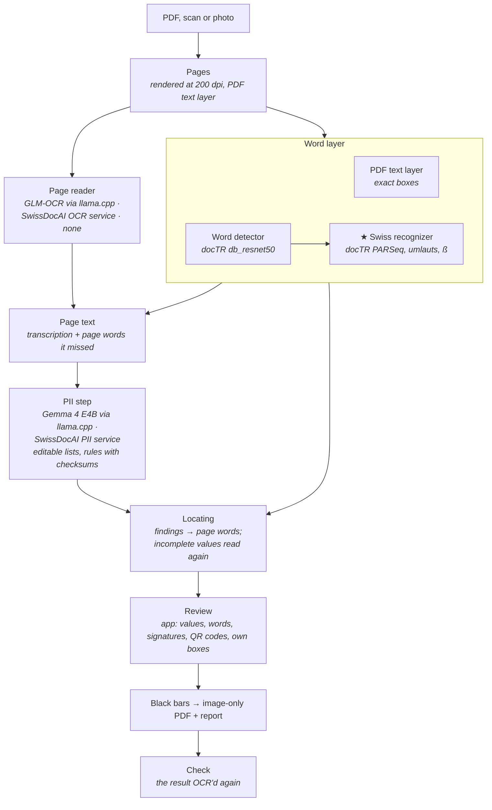
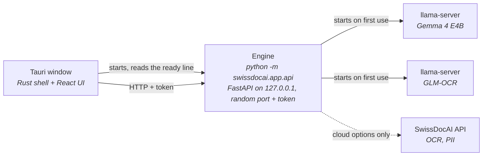

# SwissDocAI Redact — architecture

## Redaction: document → redacted PDF

One model is trained in this project (★); the others are used as published, and
everything else is rules and alignment.

| Step | Runs | Code |
|---|---|---|
| Pages, PDF text layer | here | `swissdocai/pipeline.py`, `swissdocai/words.py` |
| OCR: docTR detector + ★ Swiss recognizer | here, ONNX Runtime (DirectML / CPU) | `swissdocai/words.py`, `swissdocai/models/` |
| Page reader | here (llama.cpp), or the SwissDocAI OCR service | `swissdocai/engine.py`, `swissdocai/saas.py` |
| PII step | here (llama.cpp), or the SwissDocAI PII service | `swissdocai/pii.py`, `swissdocai/policy.py`, `swissdocai/saas.py` |
| Locating, bars, report, check | here | `swissdocai/redact.py`, `swissdocai/align.py` |

Born-digital PDFs mostly need no OCR: their text layer gives exact words, and OCR
only fills in what it lacks (text in images, form fields). Scans and photos are
OCR'd.

The two readings check each other. The page reader's text is what the PII step
reads, and words it skipped are added from the word layer. The word layer's boxes
are where the bars go, and a finding is only blacked out where its letters are on
the page.

## Processes: the desktop app

- **Start.** The Rust shell starts the engine (`SWISSDOCAI_ENGINE` in development,
  else `swissdocai-engine`, which the installer ships in the app's `engine/` folder,
  frozen by `installer/build.py`). It waits for the line
  `SWISSDOCAI_ENGINE_READY <port>` and passes port and token to the UI.
- **Models.** The engine runs OCR in-process with OnnxTR (DirectML on Windows with a
  GPU, else the CPU; the CPU too when DirectML fails). It starts one `llama-server` per model on a
  free local port the first time it is needed. On first start it downloads the
  llama.cpp build for this machine's GPU and the models into its cache
  (`%LOCALAPPDATA%\swissdocai`), each checked against its SHA-256. The build is
  chosen from the hardware: CUDA (NVIDIA), ROCm (AMD, where AMD's ROCm libraries
  are installed), Metal (Apple silicon), Vulkan (any other GPU, and the fallback),
  CPU. Each build is asked which GPUs it sees (`llama-server --list-devices`)
  before it is kept (`llama.cpp/backend.json`); one that sees none is deleted and
  the next is tried. A model server that fails on the GPU is started again on the
  CPU.
- **State.** Settings (`settings.json`) and logs (`engine.log`,
  `llama-server-<model>.log`) live in the same folder. The SwissDocAI token is stored
  encrypted (Windows DPAPI). Documents stay where they are; the redacted PDF goes
  where the user saves it.
- **Exit.** On close the shell asks the engine to stop (`/api/shutdown`). The engine
  stops its model servers and exits, and is ended after a few seconds if it does
  not. The engine also watches the shell's process (`--parent-pid`) and stops the
  same way when the app is killed or crashes; on Windows its model servers sit in a
  job object that ends them even when the engine itself is killed.

The command line (`swissdocai redact`) runs the same pipeline in one process,
without review.
